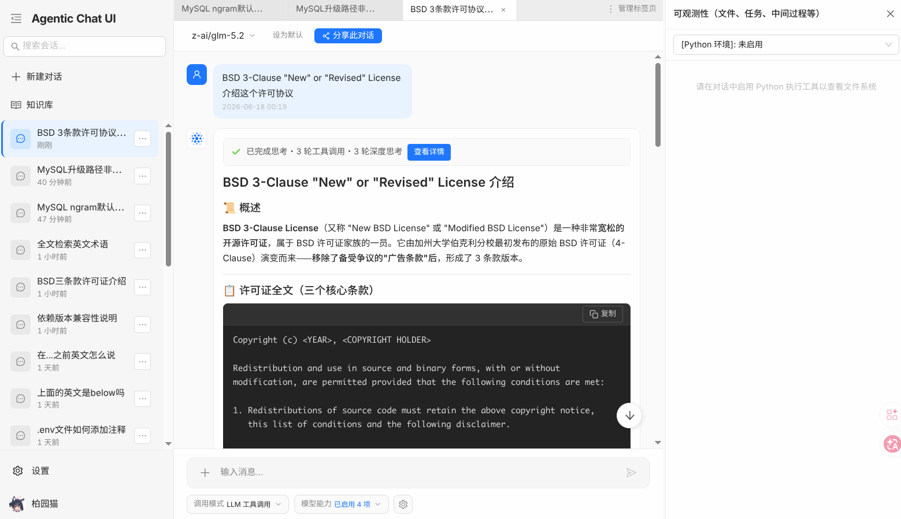

# jiallo-platform

[简体中文](./README.zh-CN.md)

A unified AI platform based on Spring AI Alibaba, Antd Design and other popular technologies. Currently provided Agentic Chat UI experience and RAG functionality. Suitable for both personal deployment and deploy as SaaS.

> Additional Notice: Currently the interface only supports Chinese (Simplified) as interface language.

## Features

* Full-text search based RAG
* High performance and easy to scale-out
* Multi-User design
* User group
* Share conversations
* Agentic Chat UI
* Secure by-default
* Java-based

## Documentation

* [Installation](./docs/en/installation.md)
* [First Setup](./docs/en/first-setup.md)
* [Local Development](./docs/en/development.md)

## License

BSD 3-Clause "New" or "Revised" License

## Contributions

PR/Issues welcome!

If you find security issues, we recommend you to contact me privately at baiyang-lzy@outlook.com instead of publishing on the issue section. Thanks!

## Special Thanks

See [THANKING.md](./THANKING.md).
